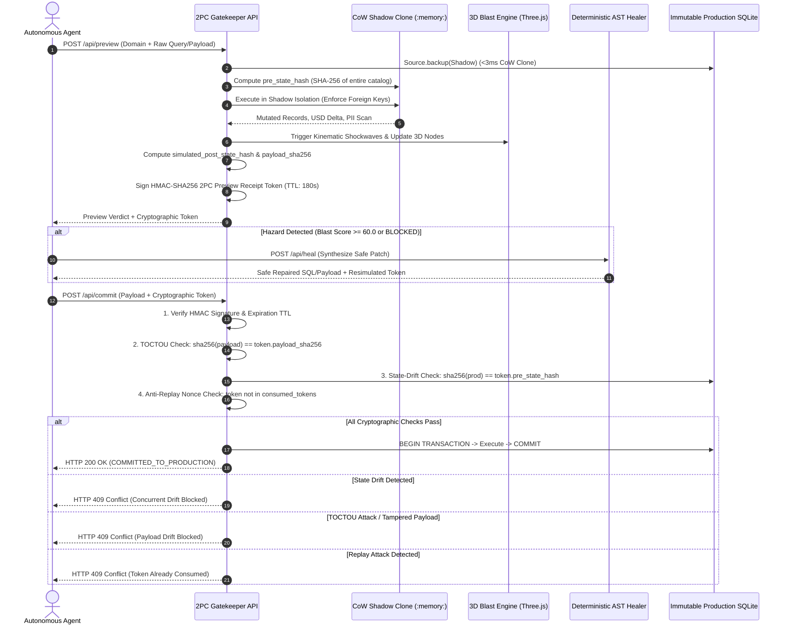

# COGNITION / AETHELGARD: DETERMINISTIC AI ACTION SIMULATOR & 2PC SAFETY GATE

> **Simulated Consequences Before Real Action**  
> *A high-throughput, deterministic pre-commit sandbox, autonomous agent interceptor, and cryptographic Two-Phase Commit (2PC) safety gate for mission-critical infrastructure.*

---

## 1. Executive Summary & Problem Statement

Autonomous AI agents executing directly against operational databases, payment rails, or client communications present severe risks of catastrophic failures: cascading relational deletions, irreversible financial drains, regulatory PII disclosures, and authentication downgrades.

**Aethelgard** solves this by establishing a non-bypassable, deterministic **Pre-Commit Simulation & Cryptographic 2PC Gatekeeper**:
1. **Dynamic Copy-on-Write (CoW) Shadow Sandbox:** Every proposed agent action is cloned into an isolated, in-memory SQLite sandbox (`prod_conn.backup(shadow_conn)` in <3ms).
2. **Dynamic Causal Blast-Radius Calculation:** Calculates the mathematical delta in row counts, financial liabilities ($ ARR / ledger volume), and PII risk on the fly—with **zero hardcoded fallback dictionaries**.
3. **Reactive 3D WebGL Consequence Engine:** Visualizes the infrastructure topology graph in Three.js, pulsating affected nodes and driving shockwaves sized strictly by live blast metrics.
4. **Autonomous Self-Healing Engine:** Synthesizes safe Abstract Syntax Tree (AST) patches to repair dangerous mutations before human review.
5. **Cryptographic Two-Phase Commit (2PC) Protocol:** Binds each preview to a tamper-evident HMAC-SHA256 token that enforces Time-of-Check to Time-of-Use (TOCTOU) payload integrity, state drift rejection, and anti-replay guarantees.

---

## 2. Cryptographic Two-Phase Commit (2PC) Architecture



---

## 3. Core Capabilities

### 3.1 Dynamic Natural-Language Agent Intent Interception
- **Endpoint:** `POST /api/agent/plan`
- **Zero Preset Lookups:** Dynamically parses natural-language tasks (e.g. *"Delete all trial accounts and refund order #104"*), extracts target tables (`enterprise_accounts`, `payment_ledger`, `service_configs`, `outbound_mail_queue`), determines action parameters and amounts, and synthesizes executable SQL or JSON payloads.
- **Graceful Diagnostics on Gibberish:** Returns structured diagnostic errors when prompts contain no recognizable infrastructure entities or intents.

### 3.2 100% Dynamic Simulation in In-Memory SQLite Clone
- **Endpoint:** `POST /api/preview`
- **Arbitrary Input Execution:** Accepts any valid or unseen SQL/JSON payload typed by users or dispatched by agents.
- **Cascading Foreign-Key Calculations:** Enforces `PRAGMA foreign_keys = ON;` and captures cascading deletions (e.g. deleting enterprise accounts cascades across `payment_ledger`).
- **Real Error Propagation:** Real SQLite exceptions (`no such table`, `syntax error`) are propagated cleanly to the response (zero silent fallbacks).

### 3.3 Interactive 3D WebGL Topology Engine
- Built with Three.js (`threeui.com` aesthetic) running at 60 FPS in a dedicated WebGL canvas.
- 8 infrastructure nodes with live descriptions derived from the `/api/state` catalog.
- Dynamically pulses and emits expanding torus shockwaves sized proportionally to `records_mutated` and `financial_exposure_usd`.
- Raycast camera gliding (`glideCameraToNode`) and isometric perspective presets.

### 3.4 Automated AST Self-Healing
- **Endpoint:** `POST /api/heal`
- Injects non-destructive WHERE clauses, caps unbounded loop iterations, clamps negative refund amounts, and strips malicious XSS / credential leaks.
- Instantly re-simulates the patch in shadow isolation and returns the safe payload with `blast_radius_score = 0.0`.

### 3.5 24-Case Quantitative Evaluation Benchmark
- **Endpoint:** `POST /api/benchmarks/run`
- 24 standardized test cases across SQL Deployments, Financial Rails, and Outbound Email.
- **100% Interception Rate** on 18 hazardous scenarios (0 false negatives).
- **0% False Positive Rate** on 6 routine safe actions (e.g. parameter tuning, contractual escrow releases).

---

## 4. Operational Color Palette & Editorial Design System

Aethelgard strictly adheres to a monochromatic **Blush-Porcelain Editorial Design System** with `'Times New Roman'` serif typography, high-contrast hairline borders, and zero blurry shadows:

| Token Name | Hex Code | Role |
| :--- | :--- | :--- |
| `--bg-canvas-primary` | `#FCF8F8` | Main page canvas & 3D WebGL clear background |
| `--bg-surface-secondary` | `#FBEFEF` | Sidebar panels, modal bodies, and container fills |
| `--card-fill-tertiary` | `#F9DFDF` | Interactive cards, input fields, and code editors |
| `--accent-coral` | `#F5AFAF` | Hazard indicators, active borders, and 3D shockwave rings |
| `--ink-deep` | `#2B1919` | Editorial text ink, wireframes, and button fills |

---

## 5. Directory Structure & Key Files

```
COGNITION/
├── app.py                      # FastAPI core backend, 2PC engine, SQLite shadow CoW, and REST routes
├── final_certification_suite.py# Comprehensive 12-Gate Production Certification Gauntlet (Zero-Fallback Proof)
├── verify_dynamic.py           # Verification suite asserting zero hardcoded values & dynamic SQL
├── ralph_verify.py             # 6-Gate Ralph loop verifying AST, dynamic SQL, self-heal, 2PC, benchmarks, DOM
├── prove_no_fallbacks.py       # Forensic audit script proving real DB persistence and zero fallbacks
├── redteam_breaker.py          # 5-Vector adversarial red-team exploit tester
├── test_agent_planner_5cases.py# Unit tests for dynamic natural language agent compiler
├── verify_e2e.py               # End-to-end route connectivity and catalog verification
├── requirements.txt            # Python dependencies
├── .gitignore                  # Git ignore rules for clean repository state
├── .gsd/
│   ├── SPEC.md                 # Immutable GSD architecture constraints and verification rules
│   └── TASKS.json              # GSD verification tracking matrix
└── static/
    ├── index.html              # Responsive 2-column workbench with diff modal & 3D canvas
    ├── app.css                 # Monochromatic blush-porcelain stylesheet
    ├── app.js                  # Frontend state machine, 2PC token countdown, and API client
    └── blast_canvas_3d.js      # Three.js WebGL reactive topology graph & shockwave engine
```

---

## 6. Getting Started

### 6.1 Prerequisites
- Python 3.10+ (Tested on Python 3.12)
- Modern WebGL-capable browser (Chrome, Edge, Firefox, Safari)

### 6.2 Installation
```bash
# Clone repository
git clone https://github.com/varunagarwal13/COGNITION.git
cd COGNITION

# Install dependencies
pip install -r requirements.txt
```

### 6.3 Launching the Application
```bash
# Start Uvicorn development server on port 8000
python -m uvicorn app:app --host 127.0.0.1 --port 8000
```
Open your browser and navigate to: **`http://127.0.0.1:8000`**

---

## 7. Verification & Stress Testing

Run any of the automated test suites to independently verify system guarantees:

### 1. Master 12-Gate Production Certification Gauntlet
```bash
python final_certification_suite.py
```
*End-to-end zero-fallback proof: Golden genesis attestation, <15ms CoW cloning, dynamic arbitrary SQL, Ralph self-healing, HMAC-SHA256 2PC, TOCTOU tamper rejection, state-drift rejection, 50-thread concurrency stress, agent NLP compiler diagnostics, 24-case benchmark evaluation (100% recall / 0% false positives), 5-vector red-team gauntlet, and design system/DOM integrity.*

### 2. Dynamic Execution & Anti-Hardcoding Audit
```bash
python verify_dynamic.py
```
*Injects unseen random SQL queries and dynamic agent prompts, asserts real row mutations and financial exposure without preset lookups, and verifies 2PC anti-replay.*

### 3. Ralph 6-Gate Spec-Lock Suite
```bash
python ralph_verify.py
```
*Executes static AST checks, unseen dynamic SQL, iterative self-healing, 1-char tamper rejection, 24-case benchmark accuracy, and Three.js DOM integrity.*

### 4. Forensic Anti-Fallback Audit
```bash
python prove_no_fallbacks.py
```
*Proves live SQLite cloning, cascading foreign-key deletions, exact ARR loss calculations, and real production state hash transitions.*

### 5. Adversarial Red-Team Exploit Suite
```bash
python redteam_breaker.py
```
*Simulates 5 real-world attack vectors (TOCTOU, state drift race condition, stacked SQL sandbox escape, negative refund sign inversion, and stored XSS) and asserts 100% interception.*

---

## 8. REST API Reference

| Method | Endpoint | Description |
| :--- | :--- | :--- |
| `GET` | `/api/state` | Returns live production catalog summary, table row samples, and SHA-256 state hash |
| `POST` | `/api/agent/plan` | Dynamic natural-language compiler translating tasks to executable agent tool payloads |
| `POST` | `/api/preview` | Copies production state to CoW shadow clone, executes payload, and issues 2PC token |
| `POST` | `/api/heal` | Analyzes blast radius, synthesizes safe AST patch, and validates safe re-execution |
| `POST` | `/api/commit` | Two-Phase Commit gatekeeper verifying HMAC token, TOCTOU payload match, and state drift |
| `POST` | `/api/benchmarks/run` | Executes 24 standardized quantitative evaluation cases and returns precision metrics |
| `POST` | `/api/redteam/run` | Executes 5 adversarial exploit vectors and asserts cryptographic interception |
| `POST` | `/api/reset` | Atomically restores in-memory database to pristine deterministic baseline |

---

## 9. License

MIT License. Designed and built for the Cognition AI Hackathon.
